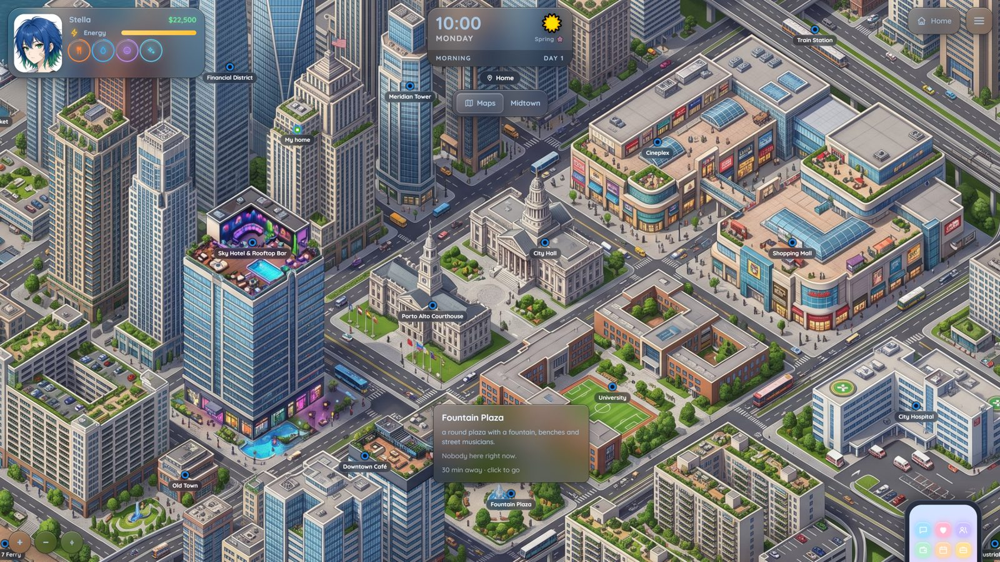

# Mundi

> **This is a fork of [tjalis/Mundi](https://github.com/tjalis/Mundi) with player state tracking.** The game now knows when you're free to walk away, held, restrained or unable to move. It tracks the people the story brings into a scene, and it can end the story when you die, fail or are captured. See [What this fork adds](#what-this-fork-adds) and the [CHANGELOG](CHANGELOG.md).

**Open worlds inside SillyTavern.** Mundi turns a SillyTavern group chat into a life you live: a city with a map and a clock, needs to look after, a job, bills, people with their own days, and the story the AI writes around what you do.

<p align="center"></p>

It is a SillyTavern **extension** (no server plugin). Everything is built on what SillyTavern already has: your character cards, personas, lorebooks and group chats. A save *is* a chat.

## What you can do

- **Live in a world.** A map of places, time that moves when you act, weather and seasons. Energy, hunger, thirst, mood and hygiene drop over time.
- **Talk.** A visual-novel scene with Say / Do / Story / See. Type `@` to pick who answers. The engine keeps the numbers (time, money, relationships); the AI writes the scene.
- **Relationships.** Friendship and romance bars with levels, approval, feelings that fade, dates, proposals, marriage, a baby. People keep their own routines: find them, or text them.
- **Work and money.** Job interviews (a d20 roll with your traits as bonus), shifts, promotions, quick gigs, courses that teach traits, weekly rent, water and power that get cut off if you don't pay. Easy / Normal / Hard.
- **A phone.** Messages, People, Jobs, Bank, Homes, Chirp (social), Spark (dating), Calendar, Journal, Shop, Goals, Profile and Help.
- **Households and "Play as".** Live with family or roommates, then switch to playing any of them.
- **A diary.** Each night the day is written as a short entry, so the story remembers what happened.
- **Make it yours.** Layouts (Visual novel, Classic, Cards), colors with transparency, presets that tint the HUD glass, a world creator for your own maps and rules.
- **Phones.** Upright and sideways layouts, with their own scale for the HUD.
- **A tour.** Stella shows you around in a practice world. No AI needed.

Two worlds come with it: **Porto Alto** (a modern coastal city) and **Valdoria** (a medieval kingdom, RPG mode coming in a later update).

## What this fork adds

- **You can't teleport out of trouble.** Each reply ends with a small hidden block that says how free you are. Leaving a conversation is rude and costs you some friendship. Getting away when someone holds or restrains you takes a d20 roll, and the story tells how it went. Unable to move means you stay.
- **People the story brings in are real.** A police officer who knocks on your door shows up in the "Here" row and on your map pin, stays in the scene prompt, and is remembered in the visit's recap.
- **Stories can end.** Dying, failing or being captured opens an ending card. Have the narrator write an epilogue, take it back ("That's not what happened"), or load a save.
- **Macros** such as `{{mundi_place}}`, `{{mundi_here}}`, `{{mundi_mobility}}` and `{{mundi_can_leave}}`, for your own cards and lorebooks.
- Turn it on or off in **Settings → Game → Player state**. The full list is in the [CHANGELOG](CHANGELOG.md).

## Screenshots

| | |
|---|---|
|  |  |
|  |  |
|  |  |

On a phone:

<p align="center">
  
  
  
  
</p>

## Install

**From GitHub (gets updates):**

1. In SillyTavern, open **Extensions → Install extension**.
2. Paste `https://github.com/coldasblues/Mundi` and install. To update later, use the update button next to Mundi under **Extensions → Manage extensions**.
3. Reload SillyTavern (Ctrl+F5). Open Mundi from the **Extensions menu** (the magic wand next to the chat box). The tour starts the first time you open it.

**Without GitHub (a zip):**

1. Get `Mundi-player-state.zip` (from this fork's Releases, or from whoever gave it to you).
2. Unzip it so you end up with `SillyTavern/data/default-user/extensions/Mundi/manifest.json`. That's for one user; use your own user folder instead of `default-user` if you have several. To install it for every user, use `SillyTavern/public/scripts/extensions/third-party/Mundi/` instead.
3. Reload SillyTavern (Ctrl+F5).

Keep only one copy of Mundi: remove or move any other Mundi folder first, or both will load. To update from a zip, replace the folder with the new one. Your saves live in your chats, not in this folder, so they stay.

Works with SillyTavern 1.19 or newer. Any chat-completion or text-completion API works; a context of about 30k tokens is a good size.


## Building from source

The repository ships the compiled `dist/` and `style.css`, so you don't need to build to use it. To change the code:

```sh
npm i -g typescript
./build.sh        # src/*.ts → dist/, css/*.css → style.css
```

## Credits

- Sounds by [Kenney](https://kenney.nl) (CC0).
- Seraphina is SillyTavern's default character; her picture is bundled for the tour.

## License

[AGPL-3.0](LICENSE), the same license as SillyTavern. The player state changes in this fork are under the same license and are listed, with dates, in the [CHANGELOG](CHANGELOG.md).
